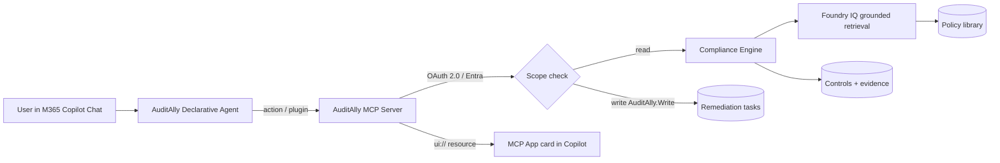

# 🛡️ AuditAlly

**Continuous audit &amp; compliance readiness agent for Microsoft 365 Copilot**
*Microsoft Agents League — Battle #3: Enterprise Agents*

AuditAlly is a **Microsoft 365 Copilot declarative agent** that turns audit season from a fire-drill into a continuous, calm cadence. Ask it anything about your controls and policies and it answers with **grounded citations** (Foundry IQ), shows a live **audit-readiness cockpit** across SOC 2 / ISO 27001 / GDPR, pinpoints the **gaps** that will fail your next audit, and — with one click — **creates remediation tasks** through an **OAuth-secured external MCP server**.

> ⚠️ **All data is synthetic.** Fictional company "Contoso", fabricated control/evidence ids
> (`CTL-004`, `EV-008`), and made-up policy documents. No real people, PII, secrets, or tenant
> data. For demonstration only.

---

## 📇 Submission details

### Tagline
> Turn audit season into a calm cadence — grounded, scored, and one click from fixed.

### Keywords
`microsoft-365-copilot` · `declarative-agent` · `enterprise-agents` · `mcp` · `mcp-apps` ·
`foundry-iq` · `agentic-retrieval` · `oauth2` · `microsoft-entra-id` · `compliance` · `audit` ·
`soc2` · `iso27001` · `gdpr` · `grounded-citations` · `responsible-ai` · `typescript` ·
`synthetic-data`

### Description
AuditAlly is a Microsoft 365 Copilot **declarative agent** for **continuous audit &amp; compliance
readiness**. It grounds every policy answer in an approved policy library with citations
(**Foundry IQ** — offline BM25-lite index that upgrades transparently to live Azure AI Search),
maps collected evidence to **SOC 2 / ISO 27001 / GDPR** controls, computes a **severity-weighted
readiness score** with framework rollups, and surfaces the **top gaps** to close before an audit.
When the user wants to act, AuditAlly calls an **external MCP server** (read *and* write) to create
and track **remediation tasks**, secured with **OAuth 2.0 / Microsoft Entra ID** and least-privilege
scopes (`AuditAlly.Read`, `AuditAlly.Write`). The MCP tools return **MCP Apps** — interactive HTML
cards (a "Compliance Cockpit" gauge, control-detail views with citations, and task confirmations)
rendered inline in Copilot. It runs **fully offline with zero Azure keys** for deterministic judging,
ships a polished browser studio that previews the exact Copilot cards, a CLI verify harness, a
Microsoft 365 Agents Toolkit app package, and Responsible-AI guardrails (PII/secret write-blocking,
prompt-injection screening, transparency notes). Built with GitHub Copilot; synthetic data only.

---

## ✨ Why this wins Battle #3

| Judging item | Required? | How AuditAlly delivers |
| --- | --- | --- |
| **M365 Copilot Chat agent** | ✅ Required | Declarative Agent ([appPackage/declarativeAgent.json](appPackage/declarativeAgent.json)) with instructions, conversation starters, and an API-plugin action. Sideloadable via ATK; works with Copilot Free. |
| **Microsoft IQ integration** | ✅ Required | **Foundry IQ** grounded, cited agentic retrieval ([src/iq/foundryIQ.ts](src/iq/foundryIQ.ts)) — offline index + live Azure AI Search. |
| **MCP Apps** | 🌟 Bonus | Interactive HTML cards returned as `ui://` resources ([src/mcp/mcpApps.ts](src/mcp/mcpApps.ts)): Compliance Cockpit, control detail, task confirmation. |
| **External MCP server (read/write)** | 🌟 Bonus | Full MCP server with read tools *and* write tools that persist remediation tasks ([src/mcp/server.ts](src/mcp/server.ts), [src/mcp/tools.ts](src/mcp/tools.ts)). stdio + streamable HTTP. |
| **OAuth security for MCP** | 🌟 Bonus | Microsoft Entra ID JWT validation (RS256 via JWKS) + least-privilege scope checks ([src/mcp/oauth.ts](src/mcp/oauth.ts)); write tools require `AuditAlly.Write`. |
| Responsible AI | ➕ Extra | Prompt-injection screening, PII/secret write-blocking, transparency notes ([src/shared/safety.ts](src/shared/safety.ts)). |
| Offline-first / reproducible | ➕ Extra | Zero keys required; deterministic scoring; `npm run verify` proves it. |

---

## 🚀 Quick start (60 seconds, fully offline)

```powershell
cd AuditAlly
npm install
npm run icons        # generate app-package PNG icons (zero-dependency)
npm run verify       # deterministic checks — should print ALL CHECKS PASSED
npm run serve        # open http://localhost:8787 for the studio
```

No `.env`, no Azure keys, no Copilot license needed for the demo. Setting the optional env vars in
[.env.example](.env.example) transparently upgrades grounding to **live Azure AI Search** and auth to
**real Entra OAuth**.

### Try it in the studio
1. Click **Ask (grounded)** → *"How often must we run an IR tabletop exercise?"* → get a cited answer.
2. Watch the **Compliance Cockpit** gauge (this is the exact MCP App card Copilot renders).
3. Click a red **gap** control → see required evidence + the grounded policy citation.
4. Click **Fix it / Create remediation task** → a task is written via the OAuth-secured write path.

---

## 🧠 How it works



See [docs/ARCHITECTURE.md](docs/ARCHITECTURE.md) for the full design and
[docs/COPILOT_USAGE.md](docs/COPILOT_USAGE.md) for sideloading + GitHub Copilot / VS Code MCP usage.

---

## 🗂️ Project layout

| Path | What |
| --- | --- |
| [appPackage/](appPackage) | M365 app package: manifest, declarative agent, API plugin, OpenAPI, instructions, icons |
| [src/mcp/](src/mcp) | MCP server (`server.ts`), tools (`tools.ts`), MCP Apps UI (`mcpApps.ts`), OAuth (`oauth.ts`), transports (`stdio.ts`, `http.ts`) |
| [src/iq/foundryIQ.ts](src/iq/foundryIQ.ts) | Foundry IQ grounded, cited retrieval (offline + live) |
| [src/domain/engine.ts](src/domain/engine.ts) | Readiness scoring, gap analysis, remediation suggestions |
| [src/shared/](src/shared) | Types, config + capability detection, Responsible-AI safety |
| [data/synthetic/](data/synthetic) | Controls, evidence, findings, and the policy knowledge library |
| [public/](public) | Browser studio that previews the exact Copilot MCP App cards |
| [docs/](docs) | Architecture, Copilot usage, evaluation-rubric mapping |

---

## 🔐 Security & Responsible AI
- **OAuth 2.0 / Microsoft Entra ID** with least-privilege scopes; write tools require `AuditAlly.Write`.
- **No secrets in the repo** — see [.gitignore](.gitignore); use [.env.example](.env.example) + Key Vault for production.
- **Write guardrails** refuse PII or secrets; **prompt-injection screening** on free-text input.
- **Transparency**: every actionable answer carries a note that AuditAlly assists — not replaces — audit judgment, and that demo data is synthetic.

## 📜 Scripts
| Command | Purpose |
| --- | --- |
| `npm run verify` | Deterministic end-to-end checks (exit 1 on failure) |
| `npm run demo` | Human-readable walkthrough |
| `npm run serve` | HTTP server + studio (http://localhost:8787) |
| `npm run mcp` | Run the MCP server over stdio (for Copilot / VS Code) |
| `npm run icons` | Generate app-package PNG icons (zero-dependency) |
| `npm run package` | Zip the M365 app package for sideloading |
| `npm run build` | TypeScript compile to `dist/` |

## 📄 License
MIT. Synthetic data only — not legal or compliance advice.
